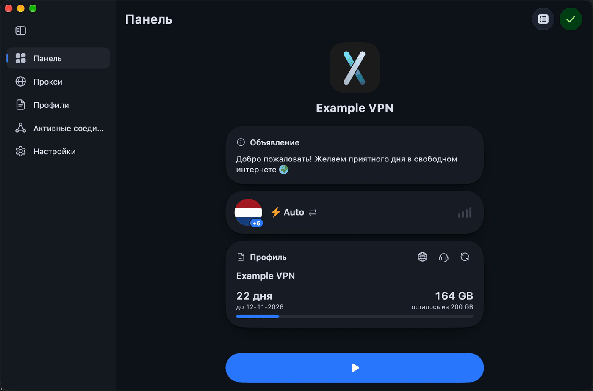
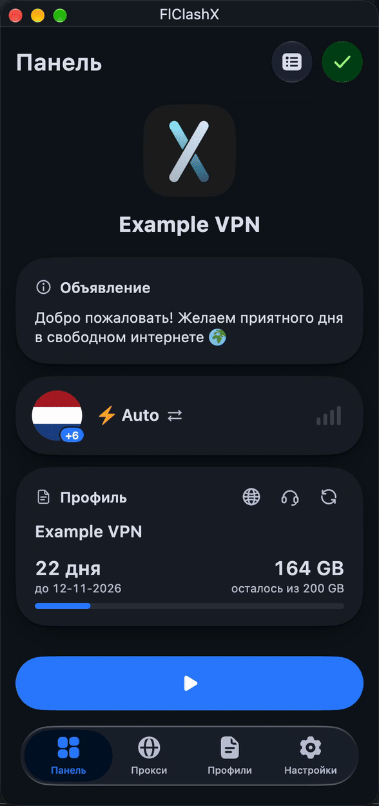

<div>

[**Russian**](README.md)

</div>

## FlClashX

[](https://github.com/pluralplay/FlClashX/releases/)
[](https://github.com/pluralplay/FlClashX/releases/)
[](LICENSE)

[](https://t.me/FlClashX)

A fork of the multi-platform proxy client [FlClash](https://github.com/chen08209/FlClash) based on Mihomo, simple and easy to use, open source and ad-free. Built for VPN services: the subscription drives the app's look and settings through the headers of the panel's response.

on Desktop:

<p style="text-align: center;">
    
</p>

on Mobile:

<p style="text-align: center;">
    
</p>

## Features

Built on FlClash v0.9.2 and the mihomo v1.19.34 core, so everything the original does works here too: profiles from a link or a file, a built-in editor, override scripts, custom rules, proxies and groups, live views of connections, requests, DNS queries and logs, backup through WebDAV or a file, a Quick Settings tile and Android TV support, a tray menu and global hotkeys on the desktop. On top of that the fork adds:

### For providers

🧾 **`flclashx-*` subscription headers:** the look of the app and the proxies tab, the cards of the dashboard and their order, a background, app switches, fallback panel addresses, the service name and logo, renew and buy-traffic buttons. See [flclashx.app](https://flclashx.app/#headers).

🔒 **Subscription settings belong to the provider:** config keys (ports, mode, TUN, stack, MTU, routes, geo and more) and headers are applied on every subscription update and when switching to the profile. Most of them the user can take over and hand back to the provider; the Android app lists and the dashboard card list always follow the subscription.

🪪 **HWID:** the app sends `x-hwid`, `x-device-os`, `x-ver-os` and `x-device-model` (Remnawave and compatible panels) and shows dialogs when the device limit is reached or a HWID is not supported.

🧭 **Extended dashboard:** the service logo and name on one row, the plan, the selected server with its flag and IP, the announcement, renew and buy-traffic buttons.

⏰ **Expiry notifications** 3, 2 and 1 days before, on the day and after the subscription ends, on every platform. Tapping one opens the renewal page.

🌐 **From the subscription YAML:** `flclashx-override` on the GLOBAL group, server and group captions (`serverDescription`, `groupDescription`), the external controller and Zashboard.

### Android

📱 **120 Hz:** while the app is on screen the display runs at its highest rate (90/120/144 Hz); in the background the rate goes back to the system.

🔔 **The VPN notification** shows only the service name from the subscription (the profile name without one) and, when turned on in Settings → General, a stop button.

🎯 **Access control:** "Smart selection" sends installed Russian apps around the VPN and every other app through it. A profile's `tun.include-package` and `tun.exclude-package` always apply and take precedence over the apps picked by hand.

🔗 **`flclashx://install-config` links** add the profile right away, without a confirmation, and the app says so.

📺 **Android TV:** an "Add profile from clipboard" button, a profile picker, sending a profile from the phone with a QR code.

### Desktop

💻 **macOS:** "Pin to menu bar" mode: the window opens from the menu bar icon, with no Dock icon.

🇷🇺 **Windows:** Russian in the installer.

### Interface

🪟 **Glass** on dashboard cards, sheets, cards and settings groups; the strength is set in the theme settings or with the `app.glass` key of the `flclashx-view` header.

📊 **Dashboard:** the status card and the announcement can be moved; the service checks include Gosuslugi, Sberbank, VK, Yandex and Kinopoisk; IP quality of the current exit.

🧭 **Proxies tab:** search, mode, latency test and fold-all sit in one button group, the rest under "More".

🛠️ **Defaults:** process lookup on, TUN on, system proxy off, proxies shown as a list, no China presets.

🗑️ **"Reset app"** in the general settings deletes every profile, the settings and the working folder and closes the app. Logs can be written to a file.

🌍 **Localization:** a reworked Russian translation, seven languages in all.

## Subscription headers and parameters

The HTTP headers of the panel's response and the YAML parameters the app understands, with examples and a panel template, are described on [flclashx.app](https://flclashx.app/#headers).

A setting the subscription sets is shown dimmed. The user can take it over, and then subscription updates and profile switches leave it alone. Right-clicking or long-pressing the row hands it back to the provider, and "Hand settings back to provider" in General → Logs and diagnostics hands back all of them at once.

## Usage

**Import a profile from a link.** Opening a link in this form adds the subscription to FlClashX right away, without a confirmation. The `clash://`, `clashmeta://`, `flclash://` and `clashx://` schemes work the same way.

```text
flclashx://install-config?url=<URL-encoded subscription link>
```

**Automate on Android.** Tasker, MacroDroid and similar apps can start, stop or toggle the VPN by starting an activity with one of these actions:

```text
com.follow.clashx.action.START
com.follow.clashx.action.STOP
com.follow.clashx.action.TOGGLE
```

From a computer, the same works over adb:

```bash
adb shell am start -a com.follow.clashx.action.TOGGLE
```

**Linux tray icon.** The `.deb` package installs its own dependencies. With the AppImage or the `.rpm`, install the AyatanaAppIndicator library:

```bash
sudo apt-get install libayatana-appindicator3-1   # Debian and Ubuntu
sudo dnf install libayatana-appindicator-gtk3     # Fedora
```

**Unattended desktop.** The core starts only after the disclaimer is accepted. Where nobody can click it, such as a container, set `FLCLASH_ACCEPT_DISCLAIMER=1` in the app's environment to accept it on first launch.

## Download

Builds are on [GitHub Releases](https://github.com/pluralplay/FlClashX/releases).

| Platform | Packages |
| --- | --- |
| Android | APK for `arm64-v8a`, `armeabi-v7a` and `x86_64`; most phones use `arm64-v8a` |
| Windows 10 and later | Installer (`.exe`) or portable `.zip`, for x64 and ARM64 |
| macOS 12 and later | DMG for Apple Silicon and Intel |
| Linux | `.deb`, `.rpm` and AppImage, for x64 and ARM64; `flclashx-bin` and `flclashx-git` on the AUR |

<a href="https://github.com/pluralplay/FlClashX/releases"></a>

## Build from source

You need [Flutter](https://docs.flutter.dev/get-started/install) 3.47 (release builds use 3.47.6), [Go](https://go.dev/dl/) 1.27 and [Rust](https://rustup.rs/) installed through rustup. Each platform builds on its own host, except Android, which builds anywhere.

```bash
git clone https://github.com/pluralplay/FlClashX.git
cd FlClashX
flutter pub get
dart setup.dart android   # or windows, macos, linux
```

Packages land in `dist/`. The Go core and the Rust libraries are compiled as part of the Flutter build.

| Platform | Also needed |
| --- | --- |
| Android | Android SDK with the NDK. Add `--arch arm64` to build a single ABI |
| Windows | [Inno Setup](https://jrsoftware.org/isinfo.php) 6 for the installer |
| macOS | Xcode and Node.js; the script installs `create-dmg` through npm |
| Linux | Debian or Ubuntu; the script installs the build packages with apt and downloads `appimagetool` |

Run `dart setup.dart --help` for the remaining options, such as `--targets` to build only some package formats.

## Star

<p style="text-align: center;">
The easiest way to support the developers is to click the star (⭐) at the top of the page.<br>
If you want to support with a small donation, you can <a href="https://t.me/tribute/app?startapp=dtyh">do so here.</a>
</p>

**TON USDT:** `UQDSfrJ_k1BdsknhdR_zj4T3Is3OdMylD8PnDJ9mxO35i-TE`
