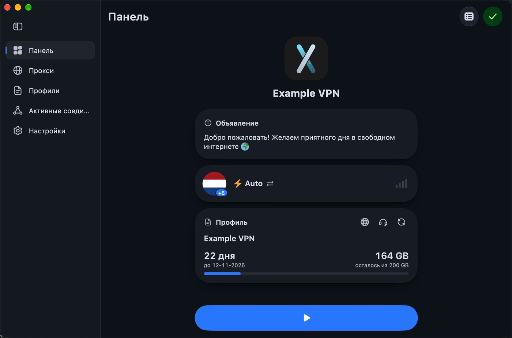
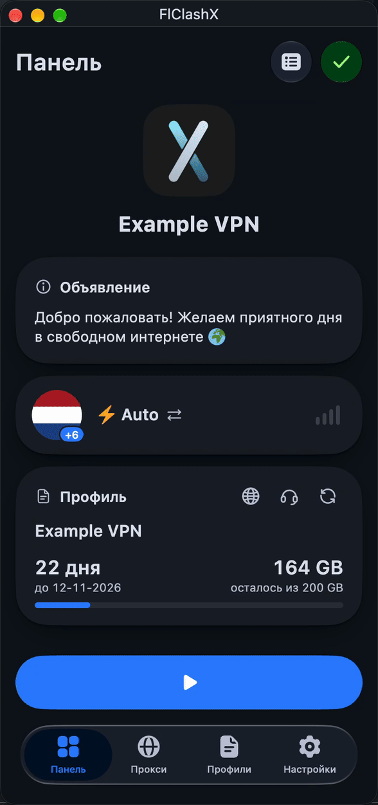

<div>

[**Russian**](README.md)

</div>

## FlClashX

[](https://github.com/pluralplay/FlClashX/releases/)
[](https://github.com/pluralplay/FlClashX/releases/)
[](LICENSE)

[](https://t.me/FlClashX)

A fork of the multi-platform proxy client FlClash based on Mihomo, simple and easy to use, open source and ad-free.

on Desktop:

<p style="text-align: center;">
    
</p>

on Mobile:

<p style="text-align: center;">
    
</p>

## Added Functionality

🛠️ Fixed default settings: process search mode on, TUN mode on, system proxy mode off, proxy list display mode set to 'list', changed camera behavior when adding a subscription via QR.

📱 **Android 120Hz Display Support:** while the app is on screen the display runs at its highest rate (90/120/144 Hz); in the background the rate goes back to the system.

🗑️ **Clear Application Data:** Added "Clear Data" button in Application Settings that removes all profiles from the profiles folder. Useful for troubleshooting or resetting the application.

🇷🇺 Added Russian language to the installer and redesigned the localization in the application.

✈️ Transmit HWID to the panel (Works only with <a href="https://github.com/remnawave/panel">Remnawave</a>).

💻 Added a new "Announcements" widget. It transmits announcements from the panel to the widget. (Works only with <a href="https://github.com/remnawave/panel">Remnawave</a>).

📺 Optimized controls for Android TV:

- Added a "Paste" button to the menu for adding a subscription via a link.
- Added a profile selection button.
- Added the ability to transfer a profile from the mobile app via a QR code.

🪪 Redesigned the profile card:

- Uses a traffic volume indicator with color change (not displayed if traffic is unlimited).
- Displays subscription expiration date (if the year is 2099, it displays "Your subscription is permanent").
- Added a new "Support" button in the profile, which pulls the supportUrl from the panel.
- The autoupdateinterval parameter for the profile is now correctly transmitted from the panel.

🪪
- Added "Meta-Info" widget. Transmits subscription parameters to the widget: remaining traffic, subscription expiration date, profile name, and prominently displays days remaining until subscription expires (3 days before expiration).
- Added "serviceInfo" widget. Displays your service name. You can additionally pass the `flclashx-servicelogo` header for a custom logo (supports svg/png links), and clicking opens the support link (supportURL).
- Added "changeServerButton" widget. Clicking redirects to the proxy page.

### Subscription headers

The app reads the HTTP headers of the response that serves the subscription and keeps them on the profile. Headers are re-read on every subscription update; those that change app settings are re-applied on every update of the active profile and when switching to it. Whatever a header does not name stays as the user set it. Header names are case-insensitive. Full description with examples (Russian): [docs/panel-headers.md](docs/panel-headers.md), `flclashx-*` only: [docs/flclashx-headers.md](docs/flclashx-headers.md).

<details>
<summary><strong>What the app sends</strong></summary>

Every subscription download goes with `User-Agent: FlClashX/v<version> core/v<mihomo> Platform/<os>`, e.g. `FlClashX/v0.5.0 core/v1.19.32 Platform/android`.

When "Send HWID" is on for the profile (on by default), these are added:

| Header | Value |
|---|---|
| `x-hwid` | Android: `ANDROID_ID`; desktop: top 16 hex chars of SHA-256 of MachineGuid (Windows), systemGUID (macOS), machine-id (Linux) |
| `x-device-os` | `Android`, `Windows`, `macOS`, `Linux` |
| `x-ver-os` | OS version |
| `x-device-model` | device model |
</details>

<details>
<summary><strong>Common headers</strong></summary>

| Header | Format | Effect |
|---|---|---|
| `subscription-userinfo` | `upload=; download=; total=; expire=` | Traffic and expiry on the profile card and dashboard. `total=0` is unlimited, `expire=0` never expires. `expire` drives the expiry notices 3, 2, 1 days before, on the day and after |
| `content-disposition` | `attachment; filename="name.yaml"` | Profile name when added by link, unless `profile-title` is present |
| `profile-title` | text, base64 or `base64:<base64>` | Profile name when added by link. A name the user typed is left alone |
| `profile-web-page-url` | URL | "Website" button on the profile card |
| `profile-update-interval` | hours, above 0 | Profile auto-update interval |
| `announce` | text, base64 or `base64:<base64>` | Announcement card on the dashboard (up to 200 characters) and the text of the device-limit dialog |
| `support-url` | URL | "Support" button on the profile card and in the device-limit dialog |
| `x-hwid-max-devices-reached` | `true` | Dialog with the `announce` text and a "Support" button |
| `x-hwid-not-supported` | `true` | "HWID not supported" dialog with a "Support" button: the app did not send a HWID the subscription requires (or the platform cannot provide one) |
</details>

<details>
<summary><strong>flclashx-newdomain</strong></summary>

Up to five fallback panel addresses, comma-separated: `host`, `host:port` or `https://host`. Tried in order when the main one does not answer. After a hard failure (domain does not resolve, 404, 410) the profile moves to the address that answered for good.

```http
flclashx-newdomain: sub2.myvpn.example, https://sub3.myvpn.example:8443
```
</details>

<details>
<summary><strong>flclashx-servicename, flclashx-servicelogo, flclashx-serverinfo</strong></summary>

The header of the extended dashboard (`app.board:extended` in `flclashx-view`):

| Header | Format | Effect |
|---|---|---|
| `flclashx-servicename` | text or base64 | Service name in the header; title of the expiry notifications |
| `flclashx-servicelogo` | image URL (SVG supported), may be base64 of the URL | Logo in the header |
| `flclashx-serverinfo` | proxy group name, text or base64 | Group whose selected server is shown on the server panel with flag and IP |

```http
flclashx-servicename: MyVPN
flclashx-servicelogo: https://cdn.myvpn.example/logo.svg
flclashx-serverinfo: Auto
```
</details>

<details>
<summary><strong>flclashx-buyplan, flclashx-buytraffic</strong></summary>

| Header | Format | Effect |
|---|---|---|
| `flclashx-buyplan` | `URL` or `URL,<days>` | "Renew plan" button. With a number it appears when no more than that many days are left. Tapping an expiry notification opens it |
| `flclashx-buytraffic` | `URL` or `URL,<percent>` | Buy-traffic button. With a number it appears when no more than that percent of traffic is left |

```http
flclashx-buyplan: https://my.myvpn.example/renew,7
flclashx-buytraffic: https://my.myvpn.example/traffic,10
```
</details>

<details>
<summary><strong>flclashx-widgets</strong></summary>

`flclashx-widgets` sets the cards of the standard dashboard and their order. It does not affect the extended dashboard or the desktop layout. Names are case-insensitive.

`currentOutbound`, `announcement`, `networkSpeed`, `outboundMode`, `vpnButton` (Android only), `networkTakeover` (desktop only), `serviceStatus`, `profiles`, `proxyGroups`, `connectionStats`, `intranetIp`, `memoryInfo`.

The status card is always shown; the announcement appears by itself while the panel sends `announce`.

```http
flclashx-widgets: currentOutbound,announcement,profiles,proxyGroups,networkSpeed
```
</details>

<details>
<summary><strong>flclashx-background</strong></summary>

`URL` or `URL,<visibility 1–100>`. An image under every full-screen page, toned down with the page colour. Without a number 8 % is visible. Downloaded once into the disk cache.

```http
flclashx-background: https://cdn.myvpn.example/bg.jpg,25
```
</details>

<details>
<summary><strong>flclashx-view</strong></summary>

One line of `key:value;key:value`. Spaces are ignored, values are case-insensitive, unknown keys and values are skipped.

Proxies tab, prefix `proxies.`:

| Key | Values |
|---|---|
| `proxies.type` | `list`, `tab` |
| `proxies.sort` | `none`, `delay`, `name` |
| `proxies.layout` | `loose`, `standard`, `tight` |
| `proxies.icon` | `filled`, `plain`, `hidden` |
| `proxies.card` | `loose`, `standard`, `compact` |

App look, prefix `app.` required:

| Key | Values |
|---|---|
| `app.board` | `extended` (extended dashboard with logo, plan and server), `standard` |
| `app.navbar` | `floating`, `docked` |
| `app.tabs` | `slide`, `fade` |
| `app.glass` | `none`, `standard`, `ultra` |
| `app.color` | `RRGGBB` or `AARRGGBB`, with or without `#`; becomes the primary colour and joins the palette |
| `app.style` | `vivid`, `tinted`, `soft`, `monochrome` |
| `app.black` | `true`, `false` (pure black background in the dark theme) |

```http
flclashx-view: app.board:extended;app.color:#FF5733;app.style:soft;app.navbar:docked;proxies.type:tab;proxies.sort:delay;proxies.card:compact
```
</details>

<details>
<summary><strong>flclashx-settings</strong></summary>

Comma-separated flags. The named app switches are turned on, the rest of the list is turned off.

| Flag | Setting |
|---|---|
| `minimize` | Minimize on window close |
| `autorun` | Launch with the system |
| `shadowstart` | Silent launch, no window |
| `autostart` | Connect right after the app starts |
| `autoupdate` | Check for app updates |
| `openlogs` | Log collection |
| `closeconnections` | Close connections when the proxy changes |

```http
flclashx-settings: minimize,autostart,closeconnections
```
</details>

<details>
<summary><strong>flclashx-special</strong></summary>

Comma-separated flags.

| Flag | Effect |
|---|---|
| `androidsecure` | On Android zeroes the local ports, hides the "Port" item and turns the VPN system proxy off; subscriptions are then downloaded directly, not through a local port. Does nothing on other platforms |
| `noglobal` | Removes Global mode from the mode card and picker, the "Rules/Global" button, the tray menu and the hotkey. A selected Global becomes Rule |
| `denywidgets` | Hides the "Edit dashboard" button |

```http
flclashx-special: androidsecure,noglobal,denywidgets
```
</details>

<details>
<summary><strong>Removed headers</strong></summary>

`flclashx-hex`, `flclashx-newboard`, `flclashx-custom`, `flclashx-globalmode`, `flclashx-androidsecure` and `flclashx-denywidgets` are gone: colour and dashboard choice come from `flclashx-view`, Global mode, secure Android and the dashboard edit lock from `flclashx-special`, and header settings always apply, without the `add`/`update` policy.
</details>

### Panel template

The same set in the form panel settings accept (Remnawave and alike): a `headers` array of `key`/`value` pairs. The host headers `subscription-userinfo`, `profile-title`, `announce` and `support-url` are usually added by the panel itself.

```json
"headers": [
  {
    "key": "flclashx-view",
    "value": "proxies.type:list;proxies.sort:none;proxies.layout:standard;app.board:extended;app.tabs:slide;app.glass:ultra;app.color:#007AFF;app.style:tinted;app.black:false;app.navbar:floating"
  },
  {
    "key": "flclashx-widgets",
    "value": "profiles,announcement,intranetIp,networkTakeover,vpnButton,currentOutbound"
  },
  {
    "key": "flclashx-background",
    "value": "https://assets.example.com/back.jpg,20"
  },
  {
    "key": "flclashx-servicename",
    "value": "Example VPN"
  },
  {
    "key": "flclashx-servicelogo",
    "value": "https://assets.example.com/logo.png"
  },
  {
    "key": "flclashx-settings",
    "value": "minimize, autorun, shadowstart, autostart, autoupdate"
  },
  {
    "key": "flclashx-serverinfo",
    "value": "SERVERS"
  },
  {
    "key": "flclashx-special",
    "value": "noglobal,androidsecure,denywidgets"
  },
  {
    "key": "flclashx-buytraffic",
    "value": "https://shop.example.com/#/buy-extra-traffic,10"
  },
  {
    "key": "flclashx-buyplan",
    "value": "https://shop.example.com/#/buy-plan,7"
  }
]
```

### YAML keys in the config

Besides headers, the app reads the keys below from the subscription YAML and writes them into its settings on every subscription update and when switching to the profile. A key missing from the file goes back to its default, so a previous subscription's value never sticks.

<details>
<summary><strong>Config keys</strong></summary>

| Key | Default when not named |
|---|---|
| `mixed-port` | 7890 |
| `port`, `socks-port`, `redir-port`, `tproxy-port` | 0 |

The app's own downloads go through `mixed-port`, or `port` without it; when both are zero or `androidsecure` is set, the request goes without a local port: with TUN/VPN on it still reaches the core and follows the rules, without TUN it goes to the network directly.

| `allow-lan` | false |
| `ipv6` | true |
| `log-level` | `error` |
| `find-process-mode` | `always` (`strict` counts as `always`) |
| `interface-name` | empty |
| `routing-mark` | 0 |
| `tcp-concurrent`, `unified-delay` | true |
| `keep-alive-interval`, `keep-alive-idle`, `disable-keep-alive` | 30, 15, false |
| `external-controller` | off; an address in the file turns the controller on there |
| `secret` | empty; a controller without a secret is open without a password |
| `external-ui`, `external-ui-name`, `external-ui-url` | with the controller on, zashboard is filled in; the "Zashboard" item in settings opens it with address and secret |
| `geodata-loader` | `memconservative` |
| `geo-auto-update`, `geo-update-interval` | false, 24 |
| `geox-url` | MetaCubeX links |
| `global-ua` | the app's User-Agent; affects only the core's own downloads |
| `tun.device`, `tun.stack` | `FlClashX`, `mips` |

`mode` and `tun.enable` are set by the subscription but never reset to defaults, because the user toggles them.
</details>

<details>
<summary><strong>serverDescription and groupDescription</strong></summary>

| Key | Where | Effect |
|---|---|---|
| `serverDescription` | on a proxy in `proxies` | Caption under the node in the proxies list instead of its type; a flag in it reaches the server card |
| `groupDescription` | on a group in `proxy-groups` | Caption of a folded group in the proxies list. The group type is never shown |

```yaml
proxy-groups:
  - name: 🌍 Main VPN
    type: select
    groupDescription: Picks the best location
    proxies:
      - 🇩🇪 Germany
proxies:
  - name: 🇩🇪 Germany
    type: vless
    serverDescription: 🇩🇪 Frankfurt, 10 Gbit/s
```
</details>

### Provider and user settings

A settings row set by the subscription (switches from `flclashx-settings`, `flclashx-view` keys on the theme page and in the proxies tab settings, config keys from the table above) is shown dimmed, with a hint at the top of the page. Tapping the row asks whether the user wants to change it. After agreeing the row belongs to the user: subscription updates and profile switches leave it alone. Right-clicking or long-pressing the row offers "Hand back to provider", and "Hand settings back to provider" in General → Logs and diagnostics returns everything at once.

## Application Usage

### Linux

⚠️ Before use, ensure the following dependencies are installed:

```bash
 sudo apt-get install libayatana-appindicator3-dev
 sudo apt-get install libkeybinder-3.0-dev
```

### Android

The following actions are supported:

```bash
 com.follow.clashx.action.START

 com.follow.clashx.action.STOP

 com.follow.clashx.action.CHANGE
```

## Download

<a href="https://github.com/pluralplay/FlClashX/releases"></a>

## Star

<p style="text-align: center;">
The easiest way to support the developers is to click the star (⭐) at the top of the page.<br>
If you want to support with a small donation, you can <a href="https://t.me/tribute/app?startapp=dtyh">do so here.</a>
</p>

**TON USDT:** `UQDSfrJ_k1BdsknhdR_zj4T3Is3OdMylD8PnDJ9mxO35i-TE`
