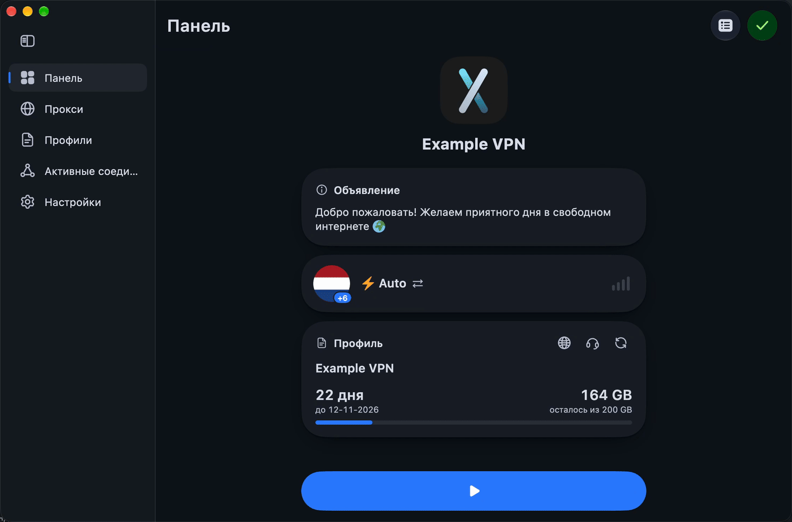
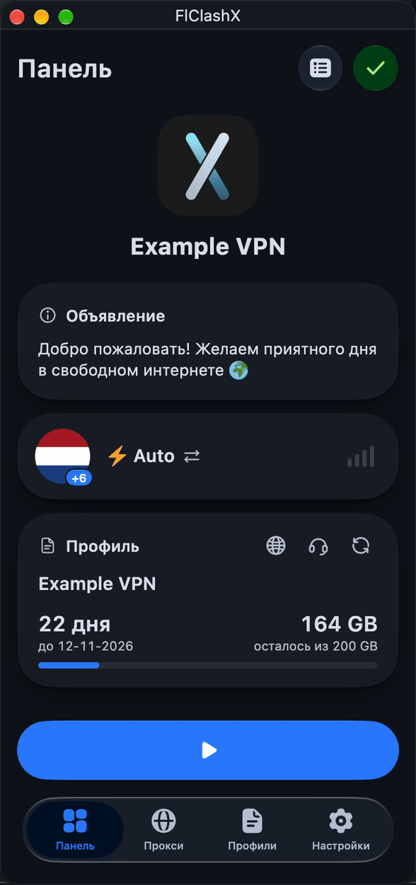

<div>

[**Русский**](README.md) · [**English**](README_EN.md)

</div>

## FlClashX

[](https://github.com/pluralplay/FlClashX/releases/)
[](https://github.com/pluralplay/FlClashX/releases/)
[](LICENSE)

[](https://t.me/FlClashX)

基于 Mihomo 的多平台代理客户端 [FlClash](https://github.com/chen08209/FlClash) 的分支，简单易用、开源、无广告。为 VPN 服务商而做：订阅通过面板的响应头控制应用的外观和设置。

桌面端：

<p style="text-align: center;">
    
</p>

移动端：

<p style="text-align: center;">
    
</p>

## 功能

基于 FlClash v0.9.2 和 mihomo v1.19.34 内核，原版的全部功能在这里都能用：从链接或文件导入配置、内置编辑器、覆写脚本、自定义规则、代理和策略组、连接/请求/DNS 查询/日志的实时查看、通过 WebDAV 或文件备份、快捷设置磁贴和 Android TV 支持、桌面端的托盘菜单和全局快捷键。在此之上，本分支还增加了：

### 面向服务商

🧾 **`flclashx-*` 订阅响应头：** 应用和代理页的外观、仪表盘卡片的集合与顺序、背景、应用开关、面板备用地址、服务名称和标志、续费与购买流量按钮。详见 [flclashx.app](https://flclashx.app/#headers)。

🔒 **订阅设置的归属固定在服务商：** 配置项（端口、模式、TUN、栈、MTU、路由、geo 等）和响应头会在每次更新订阅以及切换到该配置时应用。其中大部分用户可以自行接管，之后再交还给服务商；Android 的应用列表和仪表盘卡片集合始终跟随订阅。

🪪 **HWID：** 应用会发送 `x-hwid`、`x-device-os`、`x-ver-os` 和 `x-device-model`（Remnawave 及兼容面板），并在设备数量超限或 HWID 不受支持时弹出提示。

🧭 **增强仪表盘：** 服务标志和名称显示在同一行、套餐、带旗帜和 IP 的当前服务器、公告、续费订阅和购买流量按钮。

⏰ **到期提醒** 在到期前 3 天、2 天、1 天、到期当天以及到期之后推送，覆盖所有平台。点击通知会打开续费页面。

🌐 **来自订阅 YAML：** GLOBAL 组的 `flclashx-override`、服务器和策略组的说明文字（`serverDescription`、`groupDescription`）、外部控制器和 Zashboard。

### Android

📱 **120 Hz：** 应用在前台时，屏幕以最高刷新率（90/120/144 Hz）运行；切到后台后把刷新率交还给系统。

🔔 **VPN 通知** 只显示订阅中的服务名称（没有则为配置名称），以及在「设置 → 通用」中开启后显示的停止按钮。

🎯 **访问控制：** 「智能选择」让已安装的俄罗斯应用绕过 VPN，其他应用则走 VPN。配置中的 `tun.include-package` 和 `tun.exclude-package` 始终生效，并优先于手动选择的应用。

🔗 **`flclashx://install-config` 链接** 无需确认即可直接添加配置，应用会给出提示。

📺 **Android TV：** 「从剪贴板添加配置」按钮、配置选择器、通过二维码从手机发送配置。

### 桌面端

💻 **macOS：** 「固定到菜单栏」模式：点击菜单栏图标打开窗口，Dock 中不显示图标。

🇷🇺🇨🇳 **Windows：** 安装程序支持俄语和中文。

### 界面

🪟 **玻璃效果** 用于仪表盘卡片、抽屉、卡片和设置分组；强度可在主题设置中调整，也可通过 `flclashx-view` 响应头中的 `app.glass` 键设置。

📊 **仪表盘：** 状态卡片和公告可以调整位置；服务可用性检测包含 Gosuslugi、Sberbank、VK、Yandex 和 Kinopoisk；当前出口的 IP 质量。

🧭 **代理页：** 搜索、模式、延迟测试和折叠全部整合为一组按钮，其余放在「更多」菜单中。

🛠️ **默认设置：** 进程查找开启、TUN 开启、系统代理关闭、代理以列表显示、不含中国预设。

🗑️ **「重置应用」** 位于通用设置，会删除所有配置、设置和工作目录并关闭应用。日志可以写入文件。

🌍 **本地化：** 重做的俄语翻译，共 7 种语言。

## 订阅响应头和参数

应用支持的 HTTP 响应头和 YAML 参数，以及示例和面板模板，详见 [flclashx.app](https://flclashx.app/#headers)。

由订阅设置的选项会以灰显方式显示。用户可以自行接管，此后更新订阅和切换配置都不会改动它。右键或长按该行可以交还给服务商，「通用 → 日志与诊断」中的「将设置交还给服务商」可以一次全部交还。

## 使用

**通过链接导入配置。** 打开下面这种链接会立即把订阅添加到 FlClashX，无需确认。`clash://`、`clashmeta://`、`flclash://` 和 `clashx://` 协议的工作方式相同。

```text
flclashx://install-config?url=<URL 编码后的订阅链接>
```

**在 Android 上自动化。** Tasker、MacroDroid 及类似应用可以通过以下 action 启动 activity 来启动、停止或切换 VPN：

```text
com.follow.clashx.action.START
com.follow.clashx.action.STOP
com.follow.clashx.action.TOGGLE
```

在电脑上也可以通过 adb 完成同样的操作：

```bash
adb shell am start -a com.follow.clashx.action.TOGGLE
```

**Linux 托盘图标。** `.deb` 包会自动安装依赖。使用 AppImage 或 `.rpm` 时，请先安装 AyatanaAppIndicator：

```bash
sudo apt-get install libayatana-appindicator3-1   # Debian 和 Ubuntu
sudo dnf install libayatana-appindicator-gtk3     # Fedora
```

**无人值守的桌面环境。** 只有在接受免责声明后内核才会启动。在无人可以点击的地方（例如容器中），在应用环境中设置 `FLCLASH_ACCEPT_DISCLAIMER=1`，首次启动时就会自动接受。

## 下载

安装包发布在 [GitHub Releases](https://github.com/pluralplay/FlClashX/releases)。

| 平台 | 安装包 |
| --- | --- |
| Android | `arm64-v8a`、`armeabi-v7a` 和 `x86_64` 的 APK；大多数手机需要 `arm64-v8a` |
| Windows 10 及更高版本 | 安装程序（`.exe`）或便携版 `.zip`，支持 x64 和 ARM64 |
| macOS 12 及更高版本 | 适用于 Apple Silicon 和 Intel 的 DMG |
| Linux | `.deb`、`.rpm` 和 AppImage，支持 x64 和 ARM64；AUR 上有 `flclashx-bin` 和 `flclashx-git` |

<a href="https://github.com/pluralplay/FlClashX/releases"></a>

## 从源码构建

需要 [Flutter](https://docs.flutter.dev/get-started/install) 3.47（发布版本使用 3.47.6）、[Go](https://go.dev/dl/) 1.27，以及通过 rustup 安装的 [Rust](https://rustup.rs/)。除 Android 外，每个平台都要在各自的系统上构建；Android 可以在任何系统上构建。

```bash
git clone https://github.com/pluralplay/FlClashX.git
cd FlClashX
flutter pub get
dart setup.dart android   # 或 windows、macos、linux
```

构建产物会出现在 `dist/`。Go 内核和 Rust 库会随 Flutter 构建一起编译。

| 平台 | 额外需要 |
| --- | --- |
| Android | 带 NDK 的 Android SDK。加 `--arch arm64` 可以只构建一个 ABI |
| Windows | 用于制作安装程序的 [Inno Setup](https://jrsoftware.org/isinfo.php) 6 |
| macOS | Xcode 和 Node.js；脚本会通过 npm 安装 `create-dmg` |
| Linux | Debian 或 Ubuntu；脚本会用 apt 安装构建依赖并下载 `appimagetool` |

其余参数（例如用 `--targets` 只构建部分格式）请运行 `dart setup.dart --help` 查看。

## Star

<p style="text-align: center;">
支持开发者最简单的方式是点击页面顶部的星标（⭐）。<br>
如果想小额赞助，可以<a href="https://t.me/tribute/app?startapp=dtyh">在这里支持。</a>
</p>

**TON USDT:** `UQDSfrJ_k1BdsknhdR_zj4T3Is3OdMylD8PnDJ9mxO35i-TE`
